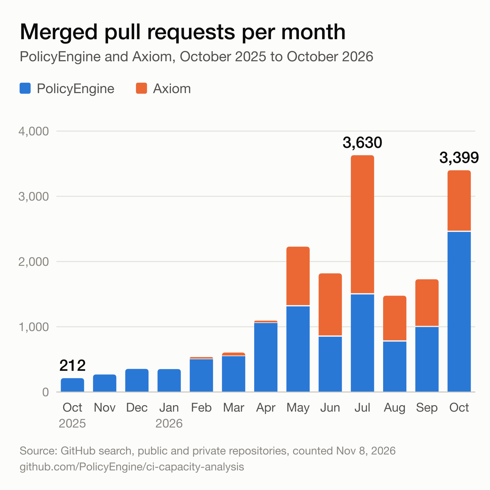
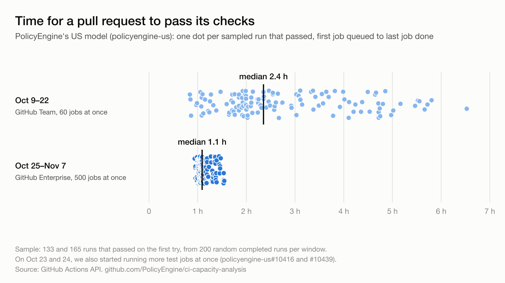

# CI capacity analysis

PolicyEngine and Axiom merged 3,399 pull requests in October 2026, 16 times as many as in October 2025. This repository counts those merges. It also measures how long pull requests to PolicyEngine's US model ([policyengine-us](https://github.com/PolicyEngine/policyengine-us)) took to pass their checks in the two weeks before and the two weeks after PolicyEngine moved from GitHub Team to GitHub Enterprise Cloud on October 23, 2026.

## Merged pull requests



| Month | PolicyEngine | Axiom | Both |
|---|---:|---:|---:|
| October 2025 | 212 | 0 | 212 |
| July 2026 | 1,496 | 2,134 | 3,630 |
| August 2026 | 773 | 703 | 1,476 |
| September 2026 | 995 | 733 | 1,728 |
| October 2026 | 2,454 | 945 | 3,399 |

[`data/merged_prs_monthly.csv`](data/merged_prs_monthly.csv) has every month from October 2025, plus November 1–7, 2026. GitHub's search API (`org:<org> is:pr is:merged merged:<first>..<last>`) supplies the counts, which cover every repository in each organization today, private ones included. The `_public` columns hold the counts anyone can reproduce without access to the organizations.

## Pull request checks on policyengine-us



| | Oct 9–22, GitHub Team | Oct 25–Nov 7, GitHub Enterprise |
|---|---:|---:|
| Jobs GitHub runs at once for the organization | 60 | 500 |
| Pull request runs that completed as success or failure | 522 (37.3 a day) | 712 (50.9 a day) |
| Sampled runs | 200 | 200 |
| Job wait for a runner, median (95% interval) | 22.0 min (15.7–26.8) | 3 s (3–3) |
| Job wait, 90th percentile / longest | 85.9 / 189.6 min | 4 s / 5.8 min |
| Jobs that waited over 5 minutes | 67.6% | 0.1% |
| Sampled runs that passed on the first try | 133 | 165 |
| Time to pass, median (95% interval) | 141 min (126–156) | 65.5 min (64.4–66.7) |
| Time to pass, 25th–75th percentile | 111–218 min | 63–71 min |

Three changes separate the windows, and this analysis doesn't split the gain among them:

- When PolicyEngine moved to Enterprise Cloud, GitHub raised its limit from 60 to 500 jobs at once on standard runners ([GitHub's Actions limits](https://docs.github.com/en/actions/reference/limits)). The organization's plan first read `enterprise` at 16:25 UTC on October 23.
- In [policyengine-us#10416](https://github.com/PolicyEngine/policyengine-us/pull/10416), merged at 22:05 UTC on October 23, Ziming Hua removed caps that held each pull request's Baseline and Contrib test suites to six jobs at a time. He had added them on October 15, in [policyengine-us#10231](https://github.com/PolicyEngine/policyengine-us/pull/10231), to share the organization's 60 runners among pull requests.
- In [policyengine-us#10439](https://github.com/PolicyEngine/policyengine-us/pull/10439), merged at 01:30 UTC on October 24, he moved the Rest Python tests, the longest path through CI, from two runners in sequence to parallel shards that a planning job balances from recent test timings.

The comparison leaves out October 23 and 24.

Jobs outside the Baseline and Contrib suites never had a cap, and they waited too. Before the caps, Baseline and Contrib jobs already waited a median 18.7 minutes:

| Job wait for a runner, median (90th percentile) | Baseline and Contrib jobs | Every other job |
|---|---:|---:|
| Oct 9–22, 110 runs created before #10231 merged | 18.7 min (89.5) | 4.2 min (56.8) |
| Oct 9–22, 90 runs created after it merged | 34.6 min (98.4) | 11.3 min (45.8) |
| Oct 25–Nov 7, 200 runs | 3 s (4 s) | 3 s (4 s) |

### Definitions

[`scripts/metrics.py`](scripts/metrics.py) holds every definition, and the property-based tests in [`tests/`](tests) check them.

- The population covers runs of `.github/workflows/pr.yaml` on `pull_request` events that completed as success or failure. A seeded generator draws 200 of them per window. Cancelled runs (usually a newer push replacing an older one) and skipped runs (draft pull requests) stay out of the sample; [`data/us_pr_frame_daily.csv`](data/us_pr_frame_daily.csv) counts them by day.
- A job's wait runs from GitHub creating the job to a runner starting it, for first-attempt jobs that got a runner. GitHub creates every job of a test suite at once, so until #10416 the later jobs of a capped suite also waited here for earlier ones to finish.
- A run's time to pass runs from its first job's creation to its last job's completion, for runs that succeeded on the first attempt with every job passing or skipped.
- A percentile bootstrap that resamples runs (2,000 draws) gives the 95% intervals, so the jobs of one run stay together.

## Reproduce

Each script makes read-only GitHub API calls through an authenticated [`gh`](https://cli.github.com/) CLI. A rerun reuses whatever an interrupted pull already saved in `data/raw/`, which git ignores.

```bash
python3 scripts/merged_prs.py        # data/merged_prs_monthly.csv
python3 scripts/collect_us_pr_ci.py  # data/us_pr_*_sample.csv, data/us_pr_frame_daily.csv
python3 scripts/analyze_ci.py        # data/us_pr_ci_summary.json
python3 scripts/charts.py            # figures/*.svg and *.png (rsvg-convert for the PNGs)
uv run --with pytest --with hypothesis python -m pytest -q tests
```

Code: MIT. Text, data and figures: CC BY 4.0.
